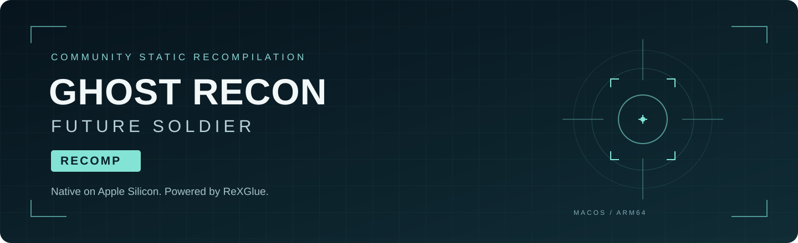
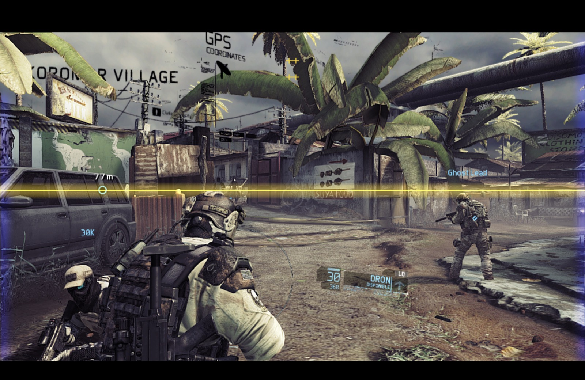
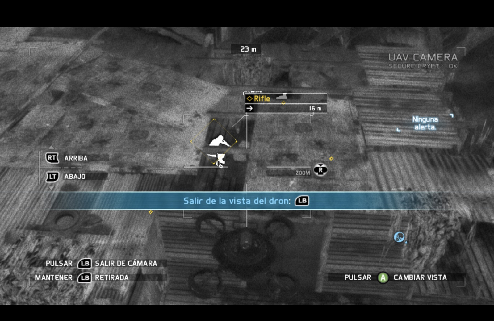
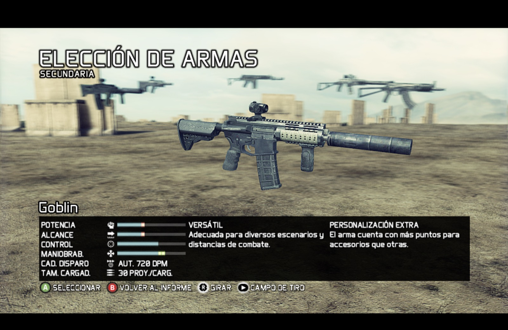
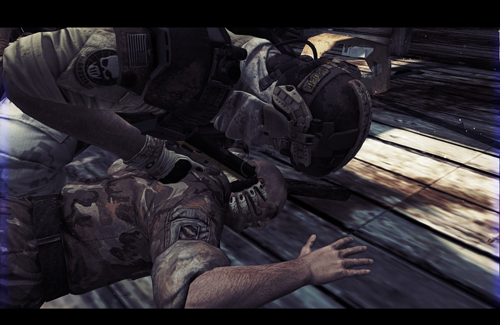
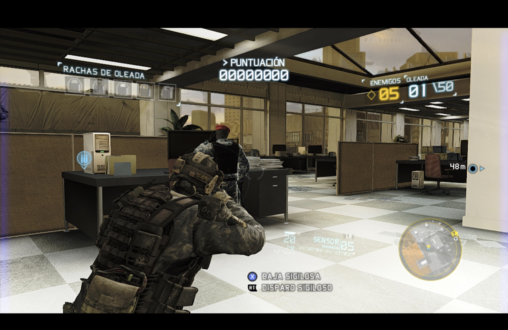
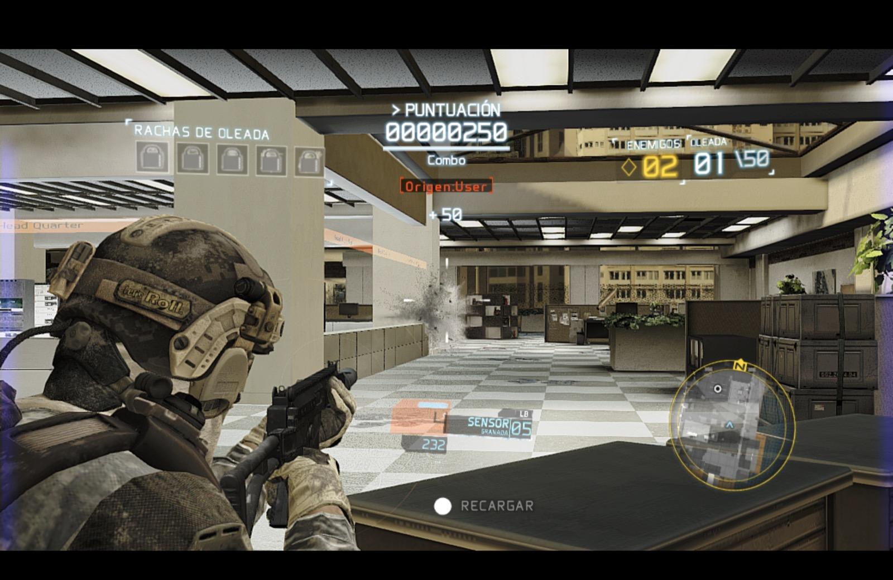

  

  
  
  

<strong>Ghost Recon Future Soldier for Xbox 360, recompiled for Apple Silicon with a native Metal renderer.</strong> Bring your own ISO. Play Campaign, Gunsmith and Guerrilla. Keep your installed game and saves when updating.

<a href="https://github.com/alex-stampede/GRFS-Recomp/releases/latest"><strong>Download for Mac</strong></a> · <a href="#install-dlc">Install DLC</a> · <a href="#getting-started">Getting started</a> · <a href="CONTRIBUTING.md">Contribute</a> · <a href="#known-issues">Known issues</a> · <a href="#support-the-project">Support</a>

## Native Metal — 3.1.4

[Version 3.1.4](https://github.com/alex-stampede/GRFS-Recomp/releases/tag/v3.1.4) restores **Extras → Options → F5** on TU3. The PC settings panel includes display mode, window size, Apple’s Metal HUD, and **Save and restart**. The launcher still installs DLC from your local folder with a progress bar.

## Native Metal — 3.1.3

[Version 3.1.3](https://github.com/alex-stampede/GRFS-Recomp/releases/tag/v3.1.3) adds **Title Update 3** to the standard launcher and signed update channel. It applies the bundled update directly to the compatible Xbox 360 release with Title ID `55530833` and Media ID `2DF41A75`. Existing installations keep their game and saves. The launcher prepares a local copy for TU3 and uses a separate TU3 shader cache.

The same native Metal renderer, uncapped host presentation, and F5 display controls carry forward from 3.1.1. All three DLC packages mounted on M4 Pro. Raven Strike's **Secure Dawn** mission started and saved to a separate campaign slot in the TU3 preview. Remaining DLC maps, audio, and the 8 GB M3 Air still need broader coverage.

The older [3.1.2 preview](https://github.com/alex-stampede/GRFS-Recomp/releases/tag/v3.1.2) used a separate profile. Its progress stays in that profile.

## Native Metal — 3.1.1

**Build 2026112601** fixes the black flashes reproduced in campaign. Metal now retires completed texture-cache work before a draw prepares its texture bindings, keeping them valid through encoding. The fix adds no GPU waits. The distant-character patch fix from 2.1.6 is included.

- **Native output with uncapped host presentation.** The original game can produce new frames at a different cadence from Metal HUD presentations.
- **F5 display controls.** Switch between fullscreen and windowed mode, choose the window size, toggle Apple’s Metal HUD, and use **Save and restart** to apply settings that require a restart.
- **Native macOS fullscreen and Game Mode support.** macOS controls when Game Mode activates.

On M4 Pro, the frame probe detected zero black outputs during a 59-second campaign run with the default texture-cache budget. The maintainer also confirmed the candidate in gameplay. The earlier dark patches on distant models were verified fixed in tested Guerrilla scenes. Longer sessions and retesting on the 8 GB M3 Air are still pending.

The current release uses the native Metal backend ported from XeniOS, static PowerPC recompilation, and the ReXGlue runtime. Xbox 360 GPU shaders are translated through SPIR-V and SPIRV-Cross into Metal shaders.

> [!IMPORTANT]
> Supply your own compatible **Xbox 360 ISO**. No ISO, original game executable, textures, audio or cinematics are included. Installation and verification happen locally; your ISO is not uploaded.

> [!WARNING]
> Experimental, ad-hoc signed and not notarized. Current binaries require **Apple Silicon and macOS 27.2 or later**. Scene-dependent performance and graphical defects remain. The Metal HUD counts presentations, which can repeat a game frame. The game's simulation speed is independent of that counter.

## Getting started

1. Download [GRFS-Recompiled-macOS-arm64.zip](https://github.com/alex-stampede/GRFS-Recomp/releases/latest/download/GRFS-Recompiled-macOS-arm64.zip).
2. Unzip and move **GRFS Recompiled.app** to **Applications**.
3. Open it and select your compatible Xbox 360 ISO if this is a new installation. TU3 is prepared automatically. Existing installations can update without reinstalling the ISO.
4. Select **Play Game** in the launcher.
5. Open **Extras → Options → F5** (Fn+F5 on some keyboards) for PC settings. Use **Save settings** to retain changes, or **Save and restart** when required.

| Requirement | Details |
| :--- | :--- |
| Mac | Apple Silicon / ARM64 |
| macOS | 27.2 or later |
| Game | Own Xbox 360 ISO matching [the compatibility manifest](launcher/compatible-game.json) |
| Development machine | Mac mini M4 Pro, 24 GB memory |
| Additional testing | MacBook Air M3, 8 GB memory |
| Storage | Extracted game plus temporary installation/update files and shader data |

The owner reports substantially smoother play with native output and unlimited presentation. This is user feedback, **not a controlled cross-device 60 FPS benchmark**. Intel Macs, other disc revisions and online multiplayer are not validated.

## Install DLC

1. When the launcher is ready, select **Install DLC…**.
2. Choose your local `55530833` folder or its `00000002` subfolder. You can import one or more of the three supported Xbox 360 DLC packages.
3. Wait for the progress bar to finish, then select **Play Game**. The DLC is installed into the standard launcher profile and remains available on subsequent launches.

The download includes TU3. DLC packages and the original Xbox 360 ISO are supplied locally by the player.

## PC settings and controls

F5 provides fullscreen/windowed preferences, window size, Save and restart, mouse sensitivity, keyboard/mouse bindings, menu-language settings and **Enable Metal HUD**. Language changes require saving and restarting. The game's audio/subtitle options remain available. Native macOS fullscreen and Game Mode support are retained; macOS controls actual Game Mode activation.

Select **Apply PC preset** to enable mouse look and these bindings:

| Input | Action / Xbox mapping |
| :--- | :--- |
| Left / right mouse button | Fire / aim |
| Middle mouse button | Right-stick press |
| R / Q | X / Y |
| C / Backspace | B — back |
| Space / ; | A — confirm |
| G / E | Left / right bumper |
| Escape / Enter | Start |
| F6 | Release / capture mouse |

The preset is opt-in. Settings persist outside the app across updates. Mouse look emulates the right stick and retains the game's turn-speed limit. Original Xbox button prompts remain; controller hardware switching has not yet been playtested. See [host UI sources and integration notes](game-src/README.md).

## Keyboard controls

The launcher enables keyboard-to-controller emulation. These are the current runtime defaults, not a remapped PC control scheme. In-game prompts still display Xbox buttons; actions depend on the current game context.

| Keyboard input | Xbox input / common use |
| :--- | :--- |
| **W / A / S / D** | Left stick — movement and menu navigation |
| **Arrow keys** | Right stick — camera / look |
| **Space** or **;** | A — confirm / contextual action |
| **Backspace** or **'** | B — back / contextual action |
| **L** | X — reload / interact, depending on context |
| **P** | Y — weapon switching / contextual action |
| **Q** or **I** | Left trigger — aim |
| **E** or **O** | Right trigger — fire |
| **1** | Left bumper |
| **3** | Right bumper |
| **F** | Left stick click |
| **K** | Right stick click |
| **Shift + Arrow keys** | D-pad directions |
| **Enter** or **X** | Start — start / pause |
| **Tab** or **Z** | Back button |

Mouse-look is **off by default** in this build: use the arrow keys for the camera. Mouse clicks are not bound to the triggers by these defaults. Modifier matching is exact, so holding Shift, Control, or Option can suppress an unmodified key binding. The Guide button is unbound.

## Project status

| Area | Status |
| :--- | :--- |
| Renderer | Native Metal in the current release; legacy Vulkan/MoltenVK in 0.10.x |
| Campaign | Gameplay, continuation, and saving a new campaign tested |
| Gunsmith / firing range | Accessible; intermittent material defects remain |
| Guerrilla | Playable in tested sections |
| Controls | Keyboard/mouse playtested; controller behavior needs more hardware testing |
| Display | Native output; unlimited host presentation; fullscreen/windowed support |
| HUD | Apple's Metal HUD, enabled/disabled from F5 |
| Updates | Signed manifest, SHA-256 verification and app replacement; persistent game/save folders retained |
| Shaders | Compiled as needed; first-use pauses can still occur |

## Known issues

- The 3.1.1 flash fix still needs extended campaign coverage and a retest on M3 Air.
- New scenes and effects can briefly pause while shaders or pipelines compile.

Previously reported Gunsmith and loading-screen HUD glitches and shadow flashes are awaiting a targeted retest on 3.1.1.

## In-game screenshots

Owner-provided captures from October 21, 2026 (earlier Vulkan builds). Campaign missions, the
campaign Gunsmith / weapon selection screen, and Guerrilla are accessible and
playable in the current port. These captures document tested sections; they do
not establish that every mission or feature is complete. Visual issues remain.

| Campaign | Campaign — drone view |
| :---: | :---: |
|  |  |
| **Campaign — Gunsmith / weapon selection** | **Campaign — takedown** |
|  |  |
| **Guerrilla — stealth** | **Guerrilla — combat** |
|  |  |

## Updates, saves and shader preparation

The launcher checks GitHub Releases and offers **Download and update** or **Not now**. The updater verifies an Ed25519-signed manifest, the ZIP checksum, app identity and build information before replacement. One previous app is kept outside Applications. If the app folder is not writable, manual installation may be required.

Persistent data lives in `~/Library/Application Support/GRFS Recompiled/`:

| Folder | Contents |
| :--- | :--- |
| `Game/` | Extracted game files |
| `UserData/` | Profile, save data and preferences |
| `Logs/` | Preparation/session logs |
| `Diagnostics/Metal-2.1-…/` | Isolated native Metal session cache directories |
| `Updates/`, `Backups/` | Staged updates and previous app backup |

Updating does not intentionally erase these folders. Older caches are retained. Current Metal startup avoids the problematic stored-pipeline preload and uses isolated session caches; **a complete, portable, precompiled pipeline pack is not available**. The preparation panel does not imply that every possible shader or pipeline has been compiled. New work can still compile during gameplay.

## Contributors wanted

Help with **Metal resource synchronization, material correctness, frame pacing, shader/pipeline compilation and reproducible builds** is welcome. This is a heavily AI-assisted experimental project. Small reviewed fixes and reproducible captures are especially valuable.

Start with [CONTRIBUTING.md](CONTRIBUTING.md), [BUILDING.md](docs/BUILDING.md), the [architecture map](docs/ARCHITECTURE.md), and [testing guide](docs/TESTING.md). Some older developer pages describe the legacy Vulkan backend; use the **versioned native Metal source overlay attached to native Metal releases** for that backend. A complete verified ISO-to-runtime rebuild remains work in progress. The launcher packaging script alone does not rebuild the game or all native Metal components.

Report problems through [GitHub Issues](https://github.com/alex-stampede/GRFS-Recomp/issues/new/choose), including release, Mac model, macOS version and reproduction steps. Review logs before attaching them. Do not upload ISOs or original game data.

## Support the project

Support helps improve GRFS-Recomp's performance, graphics and installation, and supports research into future projects such as **Ghost Recon Advanced Warfighter 1 and 2**. Future ports depend on technical feasibility. Donations are optional.

## Credits and licenses

- [ReXGlue](https://github.com/rexglue/rexglue-sdk): static recompilation runtime and SDK.
- [Xenia](https://github.com/xenia-project/xenia) and XeniOS: Xbox 360 research and the native Metal backend port. See the release source overlay for provenance and license notices.
- [SPIRV-Cross](https://github.com/KhronosGroup/SPIRV-Cross): shader translation to Metal Shading Language.
- [MoltenVK](https://github.com/KhronosGroup/MoltenVK): graphics translation used by the legacy Vulkan builds.
- [hl360-Forza2](https://github.com/0herculabs/hl360-Forza2): early reference and presentation inspiration.
- Everyone testing builds and contributing fixes.

Original launcher/tooling: [MIT](LICENSE). Third-party components retain their licenses in [THIRD_PARTY_LICENSES](THIRD_PARTY_LICENSES/) and the release package. Ghost Recon Future Soldier and its artwork belong to their rights holders. This independent project is not affiliated with Ubisoft, Microsoft or upstream projects; its license grants no rights to game assets.
