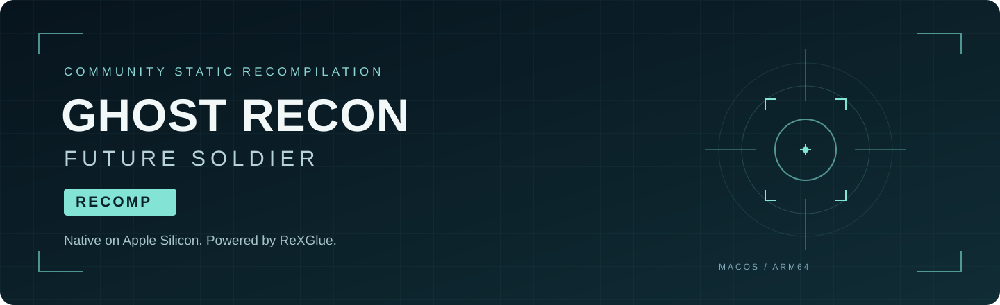

  

  
  
  
  

  <strong>A community-built native macOS recompilation of Ghost Recon Future Soldier for Xbox 360.</strong> 
  Local ISO installation. Campaign and Guerrilla. Updates that keep your saves.

  <a href="https://github.com/alex-stampede/GRFS-Recomp/releases/latest"><strong>Download for Mac</strong></a> ·
  <a href="#getting-started">Getting started</a> ·
  <a href="#project-status">Project status</a> ·
  <a href="CHANGELOG.md">Changelog</a> ·
  <a href="https://github.com/alex-stampede/GRFS-Recomp/issues/new/choose">Report an issue</a>

---

## The project

GRFS-Recomp brings the Xbox 360 version of **Ghost Recon Future Soldier** to Apple Silicon through static PowerPC recompilation. It uses the **ReXGlue** runtime and **Xenos** graphics backend, with Vulkan translated to Metal by **MoltenVK**. The download bundles the runtime and a native AppKit launcher; players do not need to install the SDK.

> [!IMPORTANT]
> **Bring your own game.** You must provide your own compatible Xbox 360 ISO. The download does not include a disc image or the original game data, textures, audio, or cinematics.

> [!WARNING]
> **This is an experimental release.** Campaign and Guerrilla have been playable on the development Mac, but visual bugs remain. The current binary requires **macOS 27.0 or newer** and has not yet been validated on a second Mac. It is ad-hoc signed, without Apple Developer ID signing or notarization.

## Highlights

- **Native Apple Silicon runtime** with a bundled graphics backend.
- **Campaign and Guerrilla** with campaign creation, saving, and continuation observed working.
- **Install from your ISO** with a 0–100% progress bar and file validation.
- **Open and play** after installation; the installer window hides while the game runs.
- **Optional in-app updates** from GitHub Releases, with an Ed25519-signed manifest and SHA-256 verification.
- **Persistent saves and shader storage** outside the app, preserved when updating.
- **A previous-version backup** when the updater replaces the app.

## Getting started

1. Download **[GRFS-Recompiled-macOS-arm64.zip](https://github.com/alex-stampede/GRFS-Recomp/releases/latest/download/GRFS-Recompiled-macOS-arm64.zip)** from the latest Release.
2. Unzip it and drag **GRFS Recompiled.app** into **Applications**.
3. Open the app and choose your compatible Xbox 360 `.iso`.
4. Let the launcher verify and extract the files. The game starts when installation finishes.
5. Next time, open the same app from Applications to launch the game directly.

The launcher currently displays its interface in **Spanish**. Installation happens locally; your ISO is not uploaded. It checks the two game executable hashes and the expected file names and sizes. Other editions or revisions may be rejected; see the [compatibility manifest](launcher/compatible-game.json).

### Requirements

| Component | Current requirement |
| :--- | :--- |
| Mac | Apple Silicon / ARM64 |
| macOS | **27.0 or later**, as required by the current binaries |
| Game | Your own Xbox 360 ISO matching the compatibility manifest |
| Storage | Space for the extracted game, shader storage, and temporary installation/update files |
| Internet | Needed to download the app and check for updates; an existing installation can start without a successful update check |

Intel Macs, Windows, Linux, other disc revisions, and online multiplayer are **not validated by this release**.

## Project status

| Area | Current state |
| :--- | :--- |
| Main menu and navigation | Working on the development Mac |
| Campaign | Creation, gameplay into mission two, saving, and continuation observed working |
| Guerrilla | Playable on the development Mac |
| Audio and controls | Reported working during playtesting |
| Graphics | Playable; cinematic flicker and scene-reload corruption remain |
| Shader storage | Persistent; first-use and some startup compilation can still occur |
| Updates | Published-download verification and replacement/backup tests passed |
| Broader compatibility | Testing on other Macs is still needed |

The current renderer uses the **FBO** path and a **mip0 workaround** from the playable baseline. This improves the observed texture seams but is not a complete mipmap fix. No fixed frame-rate guarantee is made.

## Updates without reinstalling your game

When the launcher opens, it checks the latest public Release. If a newer build is available, you can choose **Download and update** or **Not now**. The current Spanish buttons are **“Descargar y actualizar”** and **“Ahora no.”**

Before replacement, it validates the signed manifest, downloaded ZIP checksum, app identity, build number, and code signature. A separate helper replaces the app, keeps a previous copy, and opens the new version. If the app folder is not writable, the downloaded update is offered for manual installation.

**Your extracted game, saves, and shader storage stay outside the app.** If GitHub is unavailable, the launcher continues normally. Earlier prototypes need one manual app replacement to gain the updater. The first upgrade between two public Releases still needs validation.

## Saves, shaders, and logs

All persistent data lives under:

`~/Library/Application Support/GRFS Recompiled/`

| Folder | Contents |
| :--- | :--- |
| `Game/` | Extracted game files |
| `UserData/` | Profile and save data |
| `Cache/` | Known shaders and pipeline descriptions |
| `Logs/` | Game and console logs |
| `Updates/` | Downloaded and staged app updates |

**Shader storage is not a complete precompiled shader pack.** The runtime loads known shaders and pipelines, but new scenes may still trigger compilation, and some work can recur at startup. Installation reaching 100% does not mean every shader is compiled. Saves from earlier development prototypes are not automatically migrated.

## Known issues

- Black texture flicker can appear in cinematics.
- Reloading some campaign scenes can produce corrupted geometry or textures.
- First-time effects and scenes may stutter during shader compilation.
- The mip0 workaround does not fix the underlying mipmap handling.
- Public distribution is not yet notarized, and second-Mac compatibility is unverified.

Found a problem? **[Open an issue](https://github.com/alex-stampede/GRFS-Recomp/issues/new/choose)** with your Mac model, macOS version, release version, reproduction steps, and a screenshot if useful. Review logs for personal information before attaching them. Please do not upload ISOs, original executables, or game data.

<strong>Building the launcher and repository layout</strong>

### Build prerequisites

Install the Xcode command-line tools and supply a compatible, already compiled ARM64 runtime containing `grfs`, `librexruntime.dylib`, `librexgpu-xenos.dylib`, `libgrfs_AICLASS_X360_F.dylib`, `libTracyClient.dylib`, and `vulkan/`.

Set `GRFS_RUNTIME_DIR` to that directory and run `python3 launcher/build.py`. You may set `GRFS_ICON_FILE` to a local `.icns`. The packaging script builds the launcher and helper; it does **not** regenerate or rebuild the game from an ISO. Download a Release if you only want to play.

The Release also includes `ReXGlue-SDK-source.tar.gz`, a snapshot of the SDK sources and dependencies used in development. It does not contain the game code generated from the ISO. A full reproducible game-build workflow is still in development.

### Repository layout

| Path | Purpose |
| :--- | :--- |
| [`launcher/`](launcher/) | Native installer, signed updater, helper, and tests |
| [`docs/images/`](docs/images/) | README artwork and presentation assets |
| [`THIRD_PARTY_LICENSES/`](THIRD_PARTY_LICENSES/) | ReXGlue/Xenia and dependency license notices |
| [`RELEASING.md`](RELEASING.md) | Packaging, signing, and release workflow |
| [`CHANGELOG.md`](CHANGELOG.md) | Published changes |

The source repository excludes ISOs, extracted game files, saves, signing keys, compiled runtime libraries, and generated game code. See [launcher development notes](launcher/README.md) for the verification tests.

## Credits

- **[ReXGlue](https://github.com/rexglue/rexglue-sdk)** — static recompilation SDK and runtime.
- **[Xenia](https://github.com/xenia-project/xenia)** — Xbox 360 research underlying the runtime.
- **[MoltenVK](https://github.com/KhronosGroup/MoltenVK)** — Vulkan-to-Metal implementation.
- **[hl360-Forza2](https://github.com/0herculabs/hl360-Forza2)** — reference project consulted during development and inspiration for this project page.
- Everyone testing builds and reporting issues.

## License and game ownership

Original launcher and release tooling: **[MIT](LICENSE)**. Third-party components retain their own licenses, provided in [`THIRD_PARTY_LICENSES/`](THIRD_PARTY_LICENSES/) and inside the app.

Ghost Recon Future Soldier and its artwork belong to their respective rights holders. This is an independent community project, not affiliated with or endorsed by Ubisoft, Microsoft, or the upstream runtime projects. The launcher license does not grant rights to the game or its assets.
